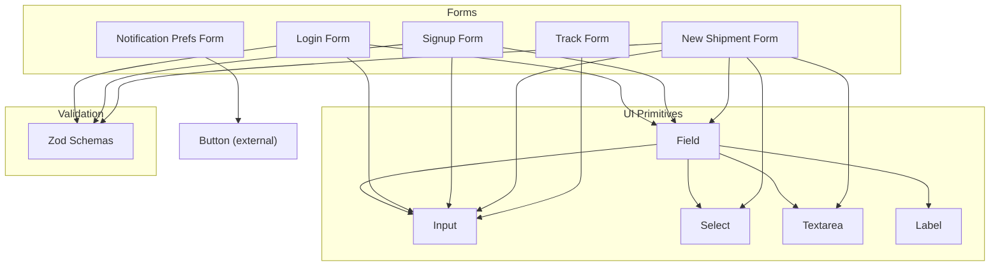
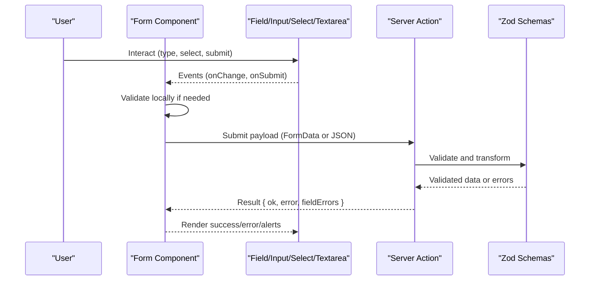
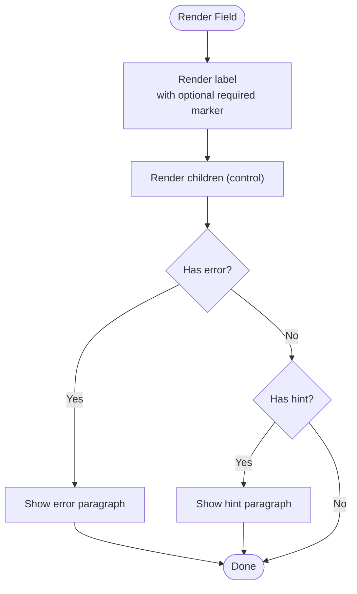
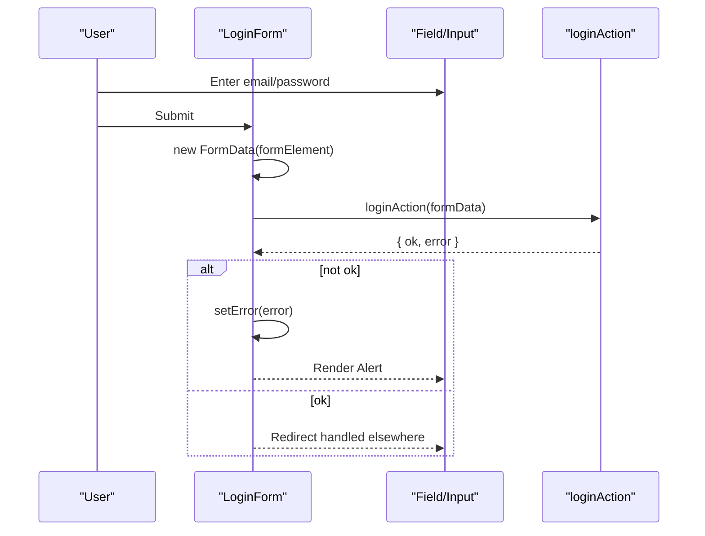
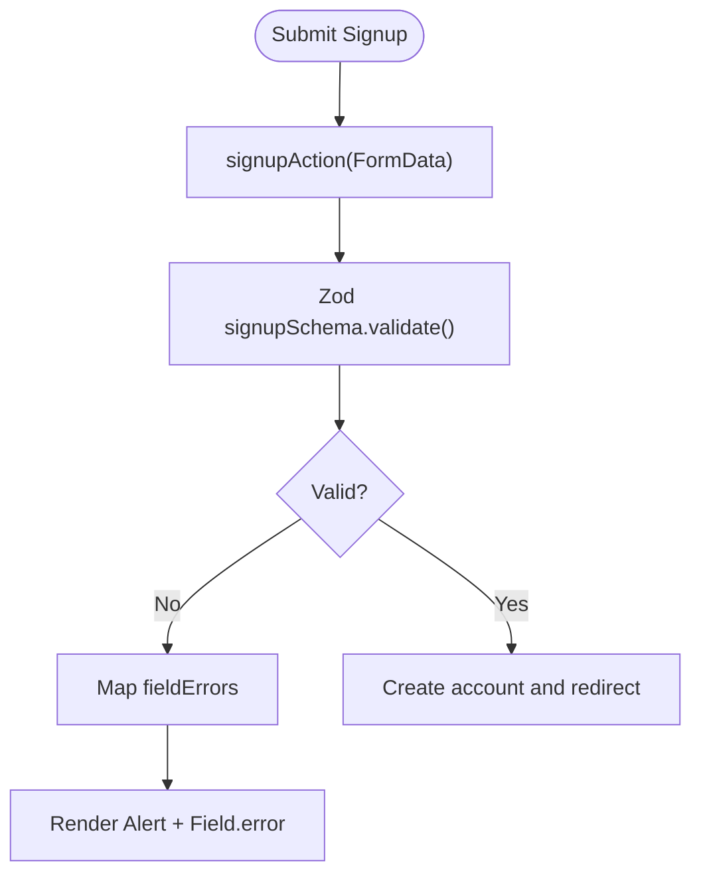
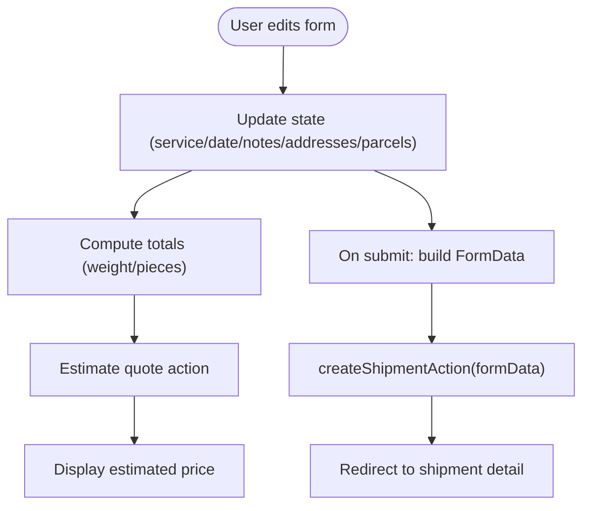
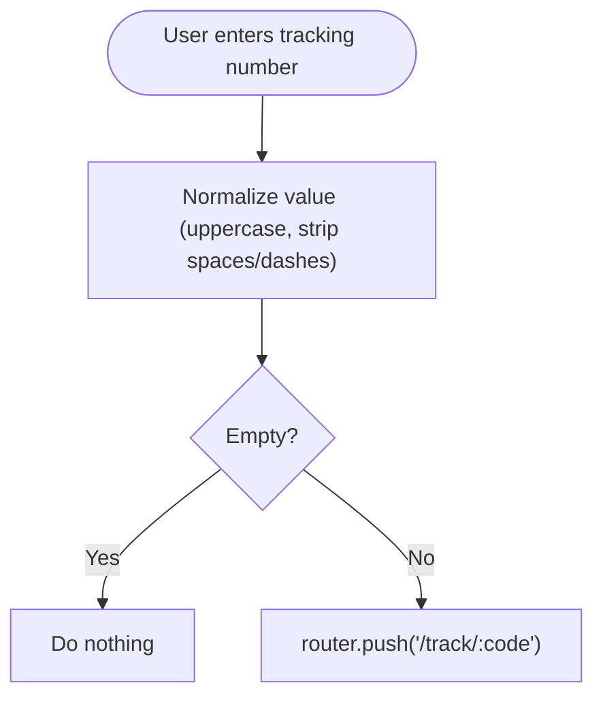
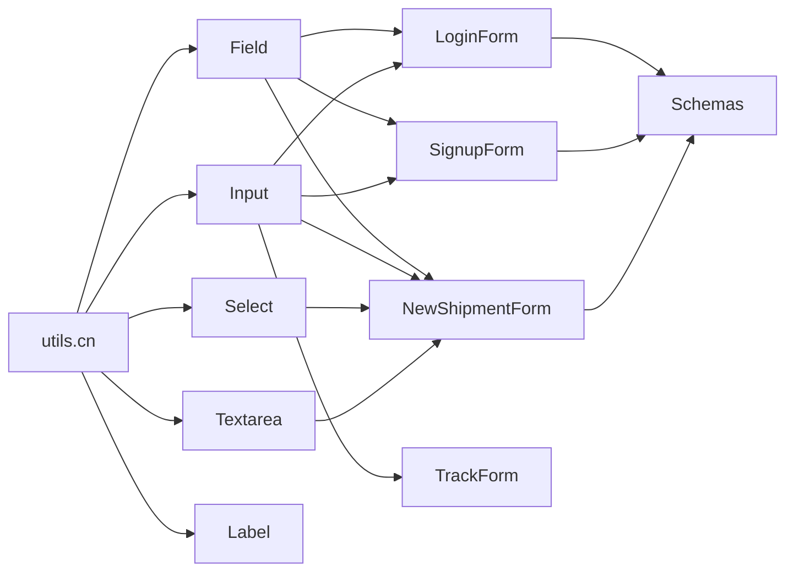

# Form Components

<cite>
**Referenced Files in This Document**
- [field.tsx](file://components/ui/field.tsx)
- [input.tsx](file://components/ui/input.tsx)
- [select.tsx](file://components/ui/select.tsx)
- [textarea.tsx](file://components/ui/textarea.tsx)
- [label.tsx](file://components/ui/label.tsx)
- [validation.ts](file://lib/validation.ts)
- [login-form.tsx](file://components/auth/login-form.tsx)
- [signup-form.tsx](file://components/auth/signup-form.tsx)
- [new-shipment-form.tsx](file://components/shipment/new-shipment-form.tsx)
- [track-form.tsx](file://components/tracking/track-form.tsx)
- [notification-prefs-form.tsx](file://components/account/notification-prefs-form.tsx)
</cite>

## Table of Contents
1. [Introduction](#introduction)
2. [Project Structure](#project-structure)
3. [Core Components](#core-components)
4. [Architecture Overview](#architecture-overview)
5. [Detailed Component Analysis](#detailed-component-analysis)
6. [Dependency Analysis](#dependency-analysis)
7. [Performance Considerations](#performance-considerations)
8. [Troubleshooting Guide](#troubleshooting-guide)
9. [Conclusion](#conclusion)
10. [Appendices](#appendices)

## Introduction
This document describes the form-related UI components and their usage patterns across the application: Field wrapper, Input, Select, Textarea, and Label. It explains how these primitives integrate with server-side validation, error handling, accessibility, layout, spacing, responsive behavior, keyboard navigation, screen reader support, and submission workflows.

## Project Structure
The form primitives live under a shared UI layer and are composed by feature-specific forms. Validation schemas are centralized and used by server actions to validate payloads. Forms demonstrate different composition patterns: controlled state, uncontrolled forms with FormData, and action-state integration.

**Diagram sources**
- [field.tsx:1-30](file://components/ui/field.tsx#L1-L30)
- [input.tsx:1-17](file://components/ui/input.tsx#L1-L17)
- [select.tsx:1-19](file://components/ui/select.tsx#L1-L19)
- [textarea.tsx:1-17](file://components/ui/textarea.tsx#L1-L17)
- [label.tsx:1-14](file://components/ui/label.tsx#L1-L14)
- [login-form.tsx:1-40](file://components/auth/login-form.tsx#L1-L40)
- [signup-form.tsx:1-39](file://components/auth/signup-form.tsx#L1-L39)
- [new-shipment-form.tsx:1-257](file://components/shipment/new-shipment-form.tsx#L1-L257)
- [track-form.tsx:1-47](file://components/tracking/track-form.tsx#L1-L47)
- [notification-prefs-form.tsx:1-64](file://components/account/notification-prefs-form.tsx#L1-L64)
- [validation.ts:1-87](file://lib/validation.ts#L1-L87)

**Section sources**
- [field.tsx:1-30](file://components/ui/field.tsx#L1-L30)
- [input.tsx:1-17](file://components/ui/input.tsx#L1-L17)
- [select.tsx:1-19](file://components/ui/select.tsx#L1-L19)
- [textarea.tsx:1-17](file://components/ui/textarea.tsx#L1-L17)
- [label.tsx:1-14](file://components/ui/label.tsx#L1-L14)
- [validation.ts:1-87](file://lib/validation.ts#L1-L87)

## Core Components
- Field: A layout wrapper that renders a label, optional required indicator, children control, and either an error or hint message. It provides consistent spacing and typography for form fields.
- Input: A styled input element with focus ring, disabled states, and accessible attributes passed through.
- Select: A styled select element with focus ring and disabled states.
- Textarea: A resizable textarea with consistent styling and focus ring.
- Label: A semantic label element with consistent typography.

Key behaviors:
- All inputs expose ref forwarding and accept standard HTML attributes.
- Field manages label association via htmlFor and displays error/hint text below the control.
- Focus styles use visible rings for keyboard users; disabled states reduce opacity and prevent pointer interaction.

Accessibility highlights:
- Field’s label is associated with the child control using htmlFor.
- Required indicators are visually marked and can be paired with aria-required when needed at the form level.
- Inputs and textareas include focus-visible outlines for keyboard navigation.

Layout and responsiveness:
- Field uses vertical stacking with small gaps.
- Forms combine Field with CSS grids for multi-column layouts on larger screens.

**Section sources**
- [field.tsx:4-29](file://components/ui/field.tsx#L4-L29)
- [input.tsx:4-16](file://components/ui/input.tsx#L4-L16)
- [select.tsx:4-18](file://components/ui/select.tsx#L4-L18)
- [textarea.tsx:4-16](file://components/ui/textarea.tsx#L4-L16)
- [label.tsx:4-13](file://components/ui/label.tsx#L4-L13)

## Architecture Overview
Forms compose UI primitives and integrate with server actions for validation and persistence. There are two primary patterns:
- Controlled client state with transitions and manual FormData construction.
- Uncontrolled forms driven by React Server Actions and useActionState.

**Diagram sources**
- [login-form.tsx:11-39](file://components/auth/login-form.tsx#L11-L39)
- [signup-form.tsx:13-38](file://components/auth/signup-form.tsx#L13-L38)
- [new-shipment-form.tsx:89-163](file://components/shipment/new-shipment-form.tsx#L89-L163)
- [validation.ts:1-87](file://lib/validation.ts#L1-L87)

## Detailed Component Analysis

### Field Wrapper
Responsibilities:
- Renders a label with optional required marker.
- Displays error or hint text beneath the control.
- Provides consistent spacing and typography.

Usage patterns:
- Wrap any input-like component.
- Pass htmlFor to associate label with the control id.
- Provide error from validation results or hint for guidance.

Accessibility:
- Uses native label semantics.
- Error and hint text are presented as paragraphs; consider aria-describedby when pairing with controls programmatically.

**Diagram sources**
- [field.tsx:14-29](file://components/ui/field.tsx#L14-L29)

**Section sources**
- [field.tsx:4-29](file://components/ui/field.tsx#L4-L29)

### Input
Responsibilities:
- Styled input with focus ring, disabled state, and placeholder styling.
- Forwards ref and accepts all standard input attributes.

Integration:
- Used inside Field for single-line text entry.
- Supports type, autoComplete, placeholder, and other native attributes.

Accessibility:
- Inherits browser defaults for keyboard navigation.
- Ensure labels are provided via Field or explicit htmlFor/id pairing.

**Section sources**
- [input.tsx:4-16](file://components/ui/input.tsx#L4-L16)

### Select
Responsibilities:
- Styled select with focus ring and disabled state.
- Accepts options as children.

Integration:
- Used inside Field for dropdown selection.
- Commonly bound to controlled state in complex forms.

Accessibility:
- Keyboard navigable; ensure each option has a meaningful value and label.

**Section sources**
- [select.tsx:4-18](file://components/ui/select.tsx#L4-L18)

### Textarea
Responsibilities:
- Styled textarea with focus ring and disabled state.
- Suitable for longer text inputs like notes.

Integration:
- Used inside Field for free-form text.

Accessibility:
- Keyboard navigable; provide clear labels and hints.

**Section sources**
- [textarea.tsx:4-16](file://components/ui/textarea.tsx#L4-L16)

### Label
Responsibilities:
- Semantic label element with consistent typography.
- Can be used standalone or within Field.

Accessibility:
- Native label semantics improve click-to-focus behavior.

**Section sources**
- [label.tsx:4-13](file://components/ui/label.tsx#L4-L13)

### Form Composition Examples

#### Login Form
- Pattern: Controlled state via useTransition and manual FormData construction.
- Submission: Prevent default, build FormData, call server action, handle non-ok response by setting local error.
- UX: Shows global alert for authentication errors; disables submit while pending.

**Diagram sources**
- [login-form.tsx:11-39](file://components/auth/login-form.tsx#L11-L39)

**Section sources**
- [login-form.tsx:11-39](file://components/auth/login-form.tsx#L11-L39)

#### Signup Form
- Pattern: Uncontrolled form with useActionState and server-side fieldErrors.
- Validation: Zod schema validates fields; errors mapped to field-level messages.
- UX: Displays global error when no fieldErrors; otherwise shows per-field errors via Field.error.

**Diagram sources**
- [signup-form.tsx:13-38](file://components/auth/signup-form.tsx#L13-L38)
- [validation.ts:9-19](file://lib/validation.ts#L9-L19)

**Section sources**
- [signup-form.tsx:13-38](file://components/auth/signup-form.tsx#L13-L38)
- [validation.ts:9-19](file://lib/validation.ts#L9-L19)

#### New Shipment Form
- Pattern: Complex controlled state with multiple sections (service, dates, addresses, parcels).
- State management: useState for service, pickupDate, notes, sender, recipient, parcels; useMemo for totals.
- Estimation: Separate action to estimate quote based on current state.
- Submission: Build FormData with serialized address and parcel arrays; navigate on success.

**Diagram sources**
- [new-shipment-form.tsx:89-163](file://components/shipment/new-shipment-form.tsx#L89-L163)
- [new-shipment-form.tsx:108-134](file://components/shipment/new-shipment-form.tsx#L108-L134)

**Section sources**
- [new-shipment-form.tsx:48-87](file://components/shipment/new-shipment-form.tsx#L48-L87)
- [new-shipment-form.tsx:89-163](file://components/shipment/new-shipment-form.tsx#L89-L163)
- [new-shipment-form.tsx:165-254](file://components/shipment/new-shipment-form.tsx#L165-L254)

#### Track Form
- Pattern: Minimal controlled input with normalization before navigation.
- Accessibility: Includes aria-label for screen readers.
- Behavior: Normalizes tracking number client-side; full validation occurs server-side.

**Diagram sources**
- [track-form.tsx:15-46](file://components/tracking/track-form.tsx#L15-L46)

**Section sources**
- [track-form.tsx:15-46](file://components/tracking/track-form.tsx#L15-L46)

#### Notification Prefs Form
- Pattern: Uncontrolled form with useActionState and checkboxes.
- UX: Shows success or error alerts based on action result.

**Section sources**
- [notification-prefs-form.tsx:16-63](file://components/account/notification-prefs-form.tsx#L16-L63)

## Dependency Analysis
- UI primitives depend on a utility function for class merging.
- Forms depend on UI primitives and server actions.
- Validation schemas are independent and consumed by server actions to validate payloads.

**Diagram sources**
- [field.tsx:1-30](file://components/ui/field.tsx#L1-L30)
- [input.tsx:1-17](file://components/ui/input.tsx#L1-L17)
- [select.tsx:1-19](file://components/ui/select.tsx#L1-L19)
- [textarea.tsx:1-17](file://components/ui/textarea.tsx#L1-L17)
- [label.tsx:1-14](file://components/ui/label.tsx#L1-L14)
- [login-form.tsx:1-40](file://components/auth/login-form.tsx#L1-L40)
- [signup-form.tsx:1-39](file://components/auth/signup-form.tsx#L1-L39)
- [new-shipment-form.tsx:1-257](file://components/shipment/new-shipment-form.tsx#L1-L257)
- [track-form.tsx:1-47](file://components/tracking/track-form.tsx#L1-L47)
- [validation.ts:1-87](file://lib/validation.ts#L1-L87)

**Section sources**
- [field.tsx:1-30](file://components/ui/field.tsx#L1-L30)
- [input.tsx:1-17](file://components/ui/input.tsx#L1-L17)
- [select.tsx:1-19](file://components/ui/select.tsx#L1-L19)
- [textarea.tsx:1-17](file://components/ui/textarea.tsx#L1-L17)
- [label.tsx:1-14](file://components/ui/label.tsx#L1-L14)
- [validation.ts:1-87](file://lib/validation.ts#L1-L87)

## Performance Considerations
- Prefer uncontrolled forms with useActionState where possible to reduce re-renders and simplify state synchronization.
- Use useTransition for long-running operations to keep UI responsive during server calls.
- Memoize derived values (e.g., totals) to avoid unnecessary recalculations.
- Avoid heavy client-side validation; rely on server-side Zod schemas for correctness and consistency.

[No sources needed since this section provides general guidance]

## Troubleshooting Guide
Common issues and resolutions:
- Missing label association: Ensure Field.htmlFor matches the control id or wrap controls with Field to auto-link labels.
- No error displayed: Verify that Field.error receives a string; check server action responses for fieldErrors mapping.
- Disabled inputs not responding: Confirm disabled prop is set appropriately and that parent containers do not intercept events.
- Focus ring missing: Ensure focus-visible styles are enabled and that elements receive focus via keyboard.
- Screen reader announcements: Add aria-live regions around dynamic alerts or errors to announce changes.

Patterns observed:
- Global alerts for non-field errors (e.g., authentication failures).
- Per-field errors rendered via Field.error for structured validation feedback.
- Pending states disable submit buttons and show spinners to indicate progress.

**Section sources**
- [field.tsx:14-29](file://components/ui/field.tsx#L14-L29)
- [login-form.tsx:11-39](file://components/auth/login-form.tsx#L11-L39)
- [signup-form.tsx:13-38](file://components/auth/signup-form.tsx#L13-L38)
- [new-shipment-form.tsx:89-163](file://components/shipment/new-shipment-form.tsx#L89-L163)

## Conclusion
The form system combines simple, accessible UI primitives with robust server-side validation. Field centralizes labeling, hints, and errors; Input, Select, and Textarea provide consistent styling and focus behavior. Forms adopt both controlled and uncontrolled patterns depending on complexity, integrating with server actions for validation and persistence. The approach supports responsive layouts, keyboard navigation, and screen reader compatibility, while keeping user feedback clear and actionable.

[No sources needed since this section summarizes without analyzing specific files]

## Appendices

### Validation Schemas Overview
Centralized Zod schemas define rules for common domains such as authentication, tracking, addresses, parcels, quotes, and notification preferences. They enforce constraints like minimum lengths, formats, ranges, and custom refinements.

Key schemas:
- Authentication: signup, login, password.
- Tracking: trackingNumber, trackingLookup.
- Address and parcels: address, parcel, shipment.
- Quote: quote.
- Notifications: notificationPrefs.

**Section sources**
- [validation.ts:4-87](file://lib/validation.ts#L4-L87)

### Accessibility Checklist
- Labels: Every input should have a visible label; Field handles this automatically when wrapped.
- Required indicators: Use Field.required and optionally aria-required on controls.
- Focus management: Ensure focus-visible rings are present; test with keyboard only.
- Error messaging: Provide concise, actionable error text; prefer inline errors near the control.
- Screen readers: Use aria-label for icon-only controls; ensure alerts are announced via aria-live when appropriate.

[No sources needed since this section provides general guidance]

### Layout and Spacing Guidelines
- Vertical stacking: Use Field’s built-in flex column and gap for consistent spacing.
- Multi-column layouts: Combine Field with CSS grid (e.g., sm:grid-cols-2/3) for responsive arrangements.
- Section grouping: Group related fields into sections with borders and headings for clarity.
- Consistent sizing: Maintain uniform heights and paddings across inputs, selects, and textareas.

**Section sources**
- [field.tsx:14-29](file://components/ui/field.tsx#L14-L29)
- [new-shipment-form.tsx:59-86](file://components/shipment/new-shipment-form.tsx#L59-L86)
- [new-shipment-form.tsx:165-254](file://components/shipment/new-shipment-form.tsx#L165-L254)