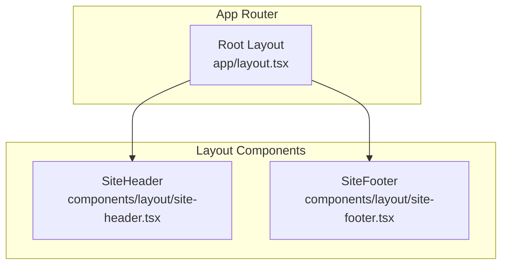
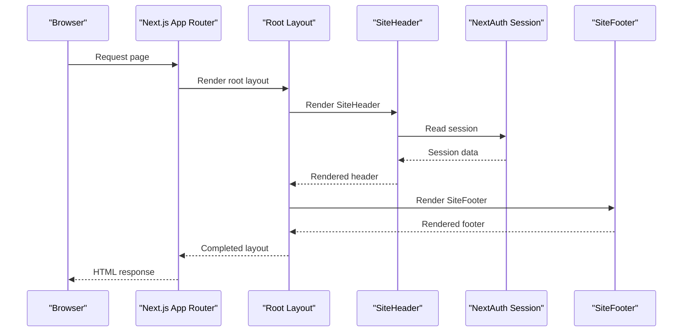
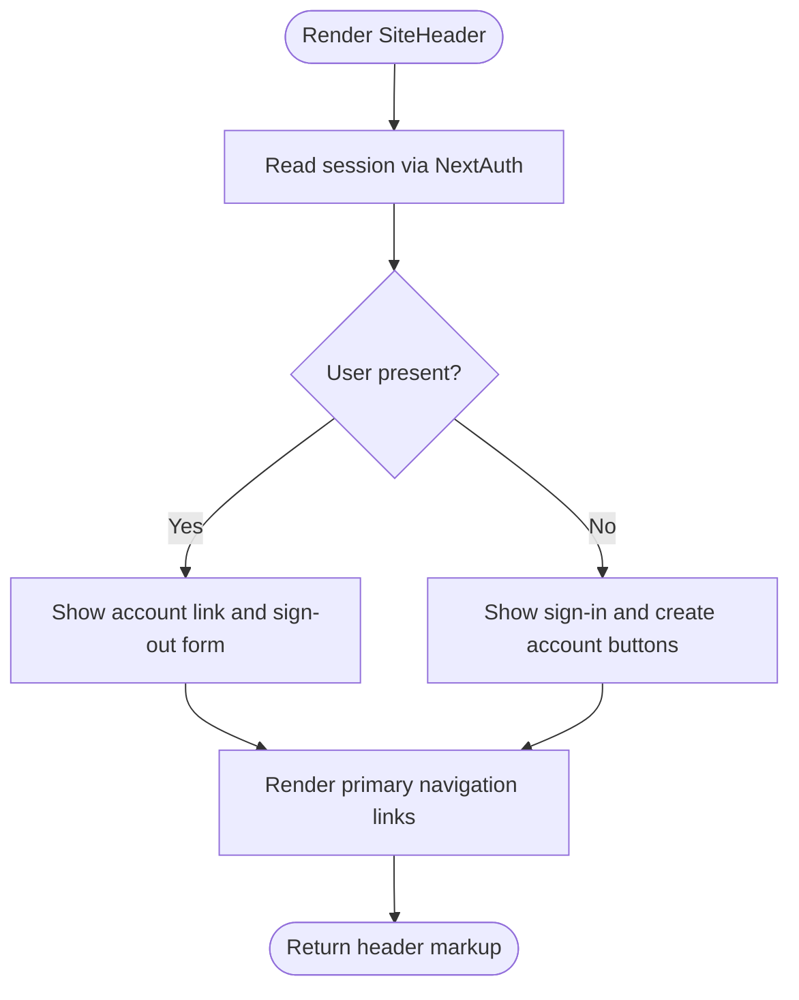
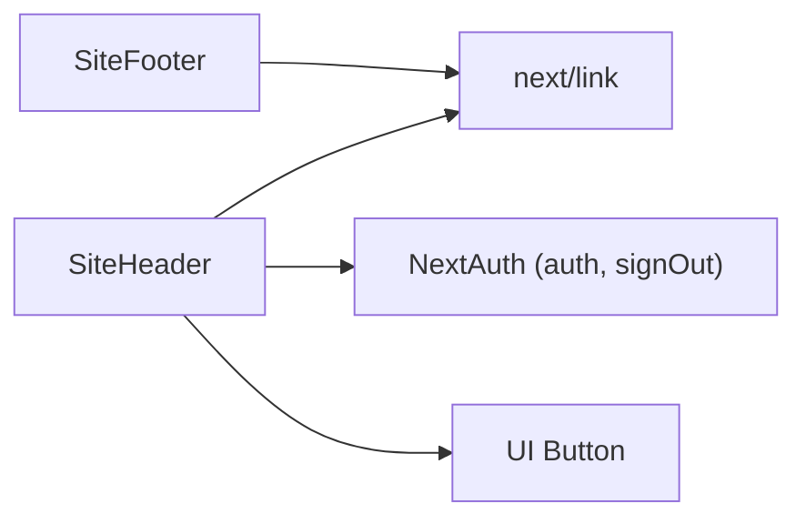

# Layout Components

<cite>
**Referenced Files in This Document**
- [site-header.tsx](file://components/layout/site-header.tsx)
- [site-footer.tsx](file://components/layout/site-footer.tsx)
- [layout.tsx](file://app/layout.tsx)
- [auth.ts](file://lib/auth.ts)
- [auth.config.ts](file://lib/auth.config.ts)
- [middleware.ts](file://middleware.ts)
- [robots.ts](file://app/robots.ts)
- [sitemap.ts](file://app/sitemap.ts)
</cite>

## Table of Contents
1. [Introduction](#introduction)
2. [Project Structure](#project-structure)
3. [Core Components](#core-components)
4. [Architecture Overview](#architecture-overview)
5. [Detailed Component Analysis](#detailed-component-analysis)
6. [Dependency Analysis](#dependency-analysis)
7. [Performance Considerations](#performance-considerations)
8. [Troubleshooting Guide](#troubleshooting-guide)
9. [Conclusion](#conclusion)

## Introduction
This document explains the layout components SiteHeader and SiteFooter, focusing on their structure, navigation patterns, responsive behavior, authentication integration, and SEO considerations. It also shows how these components integrate with Next.js App Router and provides guidance for customization and extension.

## Project Structure
The layout components live under a dedicated layout folder and are composed into the root layout:
- SiteHeader: top-of-page navigation and user actions
- SiteFooter: site-wide links and legal information
- Root layout: wraps pages with header, main content, and footer

**Diagram sources**
- [layout.tsx:20-30](file://app/layout.tsx#L20-L30)
- [site-header.tsx:12-71](file://components/layout/site-header.tsx#L12-L71)
- [site-footer.tsx:3-44](file://components/layout/site-footer.tsx#L3-L44)

**Section sources**
- [layout.tsx:1-31](file://app/layout.tsx#L1-L31)
- [site-header.tsx:1-72](file://components/layout/site-header.tsx#L1-L72)
- [site-footer.tsx:1-45](file://components/layout/site-footer.tsx#L1-L45)

## Core Components
- SiteHeader
  - Provides branding, primary navigation, and authentication-aware actions (sign in/sign up or account link/sign out).
  - Uses server-side session access to render different UI based on login state.
  - Implements sticky positioning and responsive visibility for navigation links.
- SiteFooter
  - Presents grouped navigation links (Services, Support, Legal) and a copyright notice.
  - Uses responsive grid columns to adapt from mobile to desktop layouts.

Key responsibilities:
- Consistent site-wide navigation
- Authentication state display
- Responsive design across breakpoints
- Integration with Next.js routing and metadata

**Section sources**
- [site-header.tsx:6-71](file://components/layout/site-header.tsx#L6-L71)
- [site-footer.tsx:3-44](file://components/layout/site-footer.tsx#L3-L44)

## Architecture Overview
The layout components are rendered by the root layout, which is the entry point for all pages in the App Router. The header reads the current session via NextAuth and renders appropriate UI. The footer is static but structured for easy extension.

**Diagram sources**
- [layout.tsx:20-30](file://app/layout.tsx#L20-L30)
- [site-header.tsx:12-14](file://components/layout/site-header.tsx#L12-L14)
- [auth.ts:37-41](file://lib/auth.ts#L37-L41)

**Section sources**
- [layout.tsx:20-30](file://app/layout.tsx#L20-L30)
- [site-header.tsx:12-14](file://components/layout/site-header.tsx#L12-L14)
- [auth.ts:37-41](file://lib/auth.ts#L37-L41)

## Detailed Component Analysis

### SiteHeader
Structure and behavior:
- Branding link to home
- Primary navigation array that maps to links
- Conditional rendering based on authentication state:
  - Signed-in: show account link and sign-out form
  - Signed-out: show sign-in and create account buttons
- Sticky header with backdrop blur and z-index layering
- Responsive navigation: hidden on small screens, visible at medium breakpoint

Navigation pattern:
- Centralized NAV array makes it easy to add or reorder links
- All links use Next.js Link for client-side navigation

Authentication integration:
- Reads session using NextAuth’s auth function
- Sign-out uses a server action within a form to trigger signOut with redirect

Responsive behavior:
- Navigation links hidden below medium breakpoint
- Account name link hidden below small breakpoint; button remains accessible

SEO considerations:
- Semantic header element improves accessibility and SEO
- Links provide clear anchor text for crawlers

Customization options:
- Add items to the NAV array to extend top-level navigation
- Replace brand icon/text with your logo component
- Adjust breakpoints or visibility classes to change responsive behavior
- Extend conditional logic to show additional authenticated-only links

Mobile responsiveness:
- Current implementation hides the nav on small screens; consider adding a collapsible menu if needed
- Ensure focus management and keyboard navigation when extending with a mobile menu

Extending examples:
- Add a new top-level route by pushing an object to the NAV array
- Show a notification badge next to the account link when signed in
- Integrate a theme toggle button in the right-hand controls area

**Diagram sources**
- [site-header.tsx:12-67](file://components/layout/site-header.tsx#L12-L67)

**Section sources**
- [site-header.tsx:6-71](file://components/layout/site-header.tsx#L6-L71)
- [auth.ts:37-41](file://lib/auth.ts#L37-L41)

### SiteFooter
Structure and behavior:
- Four-column responsive grid for sections: brand description, services, support, legal
- Each section contains a heading and a list of links
- Copyright line with dynamic year

Navigation pattern:
- Grouped links improve discoverability and crawlability
- Uses semantic lists and headings for better accessibility

Responsive behavior:
- Grid switches from two columns on small screens to four columns on medium and above

SEO considerations:
- Semantic footer and list elements help search engines understand site structure
- Clear link labels aid indexing

Customization options:
- Add new sections by duplicating a column block
- Update copy and links to reflect product changes
- Adjust grid breakpoints to fit more or fewer columns

Extending examples:
- Add a social media links section
- Include a newsletter signup form inside a new column
- Add a “Contact” section with email and phone links

**Diagram sources**
- [site-footer.tsx:3-44](file://components/layout/site-footer.tsx#L3-L44)

**Section sources**
- [site-footer.tsx:3-44](file://components/layout/site-footer.tsx#L3-L44)

## Dependency Analysis
The layout components depend on:
- Next.js Link for navigation
- NextAuth for session reading and sign-out
- UI primitives for buttons
- CSS utilities for layout and responsiveness

**Diagram sources**
- [site-header.tsx:1-4](file://components/layout/site-header.tsx#L1-L4)
- [site-footer.tsx:1-1](file://components/layout/site-footer.tsx#L1-L1)
- [auth.ts:37-41](file://lib/auth.ts#L37-L41)

**Section sources**
- [site-header.tsx:1-4](file://components/layout/site-header.tsx#L1-L4)
- [site-footer.tsx:1-1](file://components/layout/site-footer.tsx#L1-L1)
- [auth.ts:37-41](file://lib/auth.ts#L37-L41)

## Performance Considerations
- Server-side session read in SiteHeader avoids unnecessary client hydration for auth state.
- Sticky header with backdrop blur may impact performance on low-end devices; test scrolling performance.
- Keep the NAV array small to avoid excessive re-renders when updating navigation.
- Prefer static content in SiteFooter to minimize runtime work.

[No sources needed since this section provides general guidance]

## Troubleshooting Guide
Common issues and resolutions:
- Header does not reflect logged-in state
  - Verify NextAuth is configured and handlers are mounted.
  - Confirm middleware guards and session strategy are set correctly.
- Sign-out does not redirect
  - Ensure the sign-out form calls signOut with redirectTo.
  - Check that the route handler for NextAuth exists and is exported.
- Navigation links not appearing on mobile
  - Current implementation hides the nav below medium breakpoint; add a mobile menu if required.
- Footer links not clickable or broken
  - Validate href values and ensure target routes exist.

Relevant configuration points:
- NextAuth setup and providers
- Middleware matcher for protected routes
- Root layout composition

**Section sources**
- [auth.ts:37-41](file://lib/auth.ts#L37-L41)
- [auth.config.ts:11-41](file://lib/auth.config.ts#L11-L41)
- [middleware.ts:1-13](file://middleware.ts#L1-L13)
- [site-header.tsx:44-53](file://components/layout/site-header.tsx#L44-L53)

## Conclusion
SiteHeader and SiteFooter provide a consistent, responsive foundation for site-wide navigation and branding. They integrate cleanly with Next.js App Router and NextAuth, offering a solid base for customization. Use the provided patterns to extend navigation, adjust responsive behavior, and maintain strong SEO through semantic markup and clear link structures.

[No sources needed since this section summarizes without analyzing specific files]

## Appendices

### SEO Configuration
- Global metadata is defined in the root layout, including title templates and description.
- Robots rules disallow sensitive routes and point to the sitemap.
- Sitemap includes public marketing and utility pages.

**Section sources**
- [layout.tsx:10-18](file://app/layout.tsx#L10-L18)
- [robots.ts:1-16](file://app/robots.ts#L1-L16)
- [sitemap.ts:1-16](file://app/sitemap.ts#L1-L16)