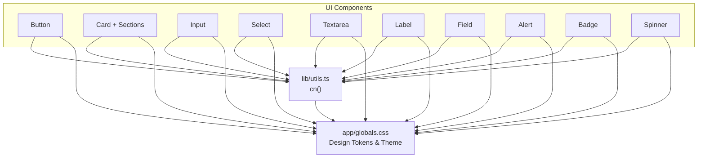
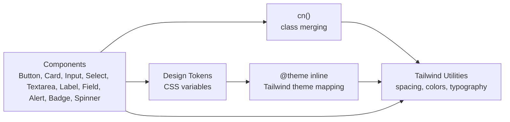
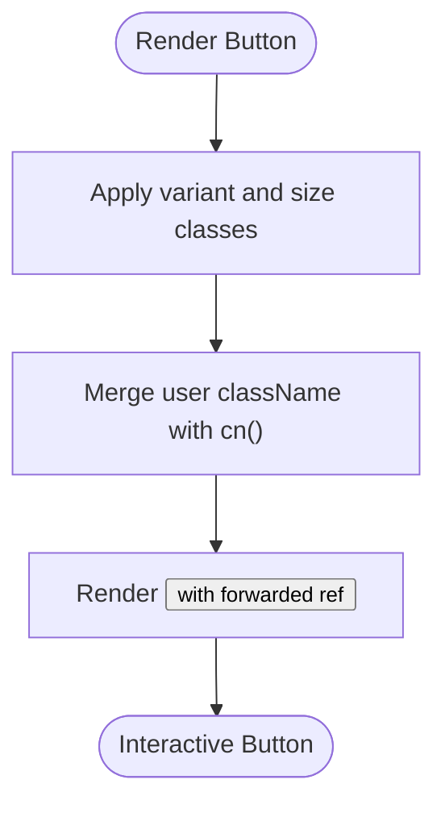
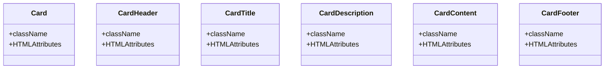
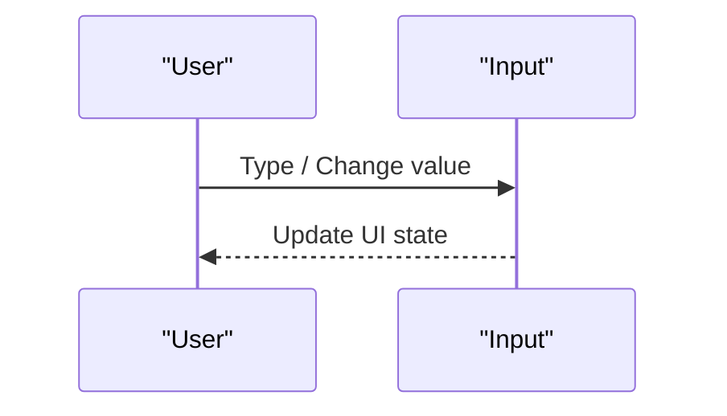
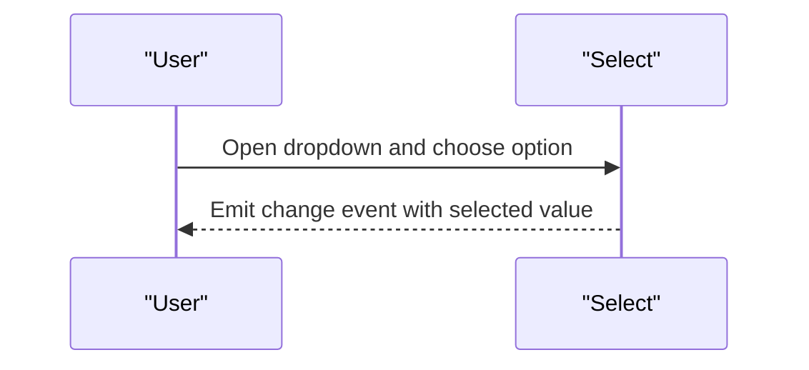
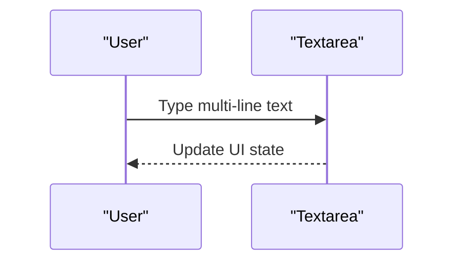
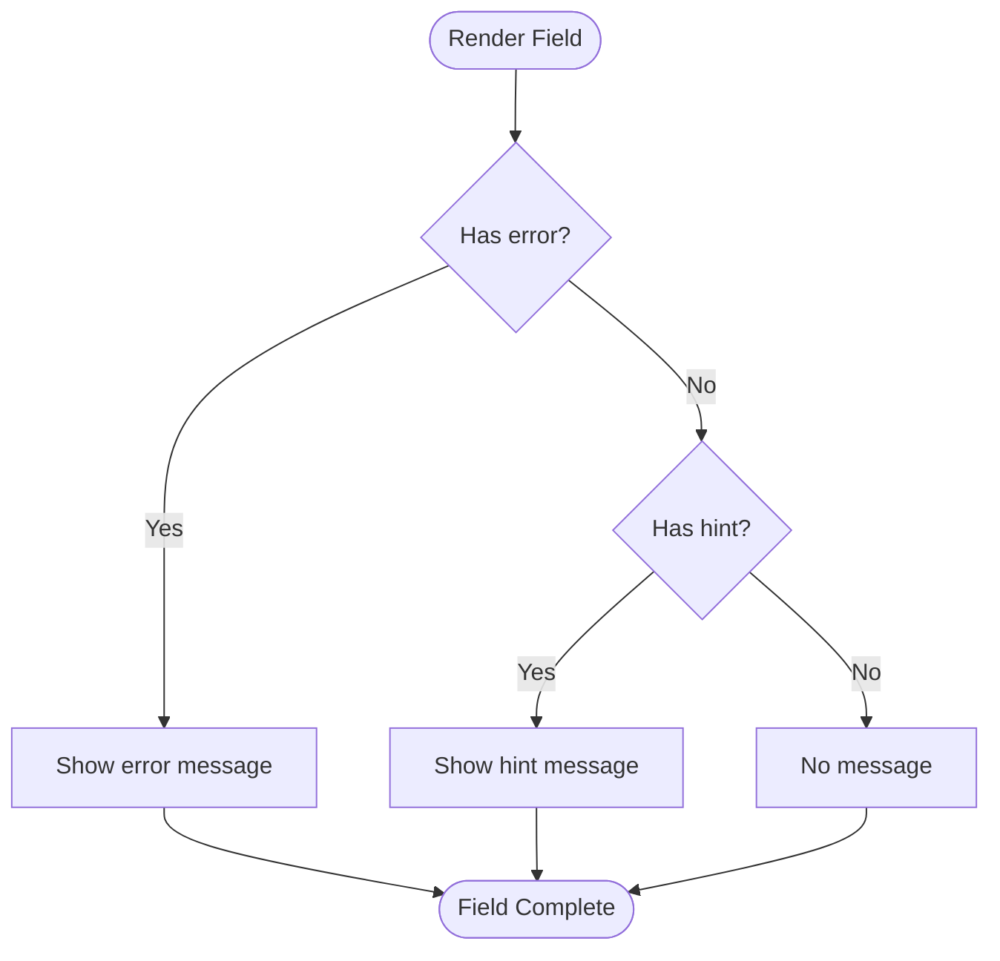
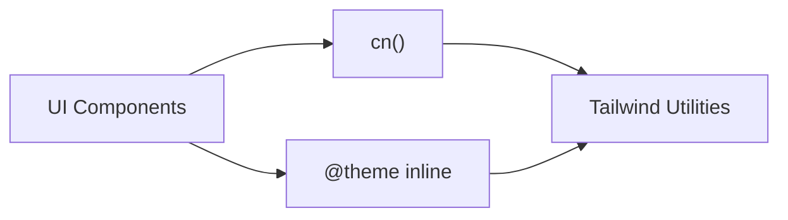

# UI Components

<cite>
**Referenced Files in This Document**   
- [button.tsx](file://components/ui/button.tsx)
- [card.tsx](file://components/ui/card.tsx)
- [input.tsx](file://components/ui/input.tsx)
- [select.tsx](file://components/ui/select.tsx)
- [field.tsx](file://components/ui/field.tsx)
- [label.tsx](file://components/ui/label.tsx)
- [alert.tsx](file://components/ui/alert.tsx)
- [badge.tsx](file://components/ui/badge.tsx)
- [spinner.tsx](file://components/ui/spinner.tsx)
- [textarea.tsx](file://components/ui/textarea.tsx)
- [utils.ts](file://lib/utils.ts)
- [globals.css](file://app/globals.css)
</cite>

## Table of Contents
1. [Introduction](#introduction)
2. [Project Structure](#project-structure)
3. [Core Components](#core-components)
4. [Architecture Overview](#architecture-overview)
5. [Detailed Component Analysis](#detailed-component-analysis)
6. [Dependency Analysis](#dependency-analysis)
7. [Performance Considerations](#performance-considerations)
8. [Troubleshooting Guide](#troubleshooting-guide)
9. [Conclusion](#conclusion)
10. [Appendices](#appendices)

## Introduction
This document describes Timberland’s reusable UI component library. It focuses on visual appearance, behavior, and interaction patterns for core components such as buttons, cards, inputs, selects, labels, fields, alerts, badges, spinners, and textareas. It also documents props, attributes, events, customization options, responsive design guidance, accessibility compliance, cross-browser compatibility, theming, style overrides, and integration with the design system using Tailwind CSS v4.

The components are built with React, styled with Tailwind CSS v4 utilities, and themed through CSS custom properties exposed via Tailwind’s theme layer. Variant-driven styling is implemented using class-variance-authority, and utility classes are merged safely with a shared cn helper.

## Project Structure
The UI components live under `components/ui`. Each file exports one or more focused components that compose Tailwind utility classes and design tokens defined in `app/globals.css`. Shared utilities are in `lib/utils.ts`, including the `cn` function used across components to merge class names.

**Diagram sources**
- [button.tsx:1-40](file://components/ui/button.tsx#L1-L40)
- [card.tsx:1-32](file://components/ui/card.tsx#L1-L32)
- [input.tsx:1-17](file://components/ui/input.tsx#L1-L17)
- [select.tsx:1-19](file://components/ui/select.tsx#L1-L19)
- [textarea.tsx:1-17](file://components/ui/textarea.tsx#L1-L17)
- [label.tsx:1-14](file://components/ui/label.tsx#L1-L14)
- [field.tsx:1-30](file://components/ui/field.tsx#L1-L30)
- [alert.tsx:1-24](file://components/ui/alert.tsx#L1-L24)
- [badge.tsx:1-28](file://components/ui/badge.tsx#L1-L28)
- [spinner.tsx:1-20](file://components/ui/spinner.tsx#L1-L20)
- [utils.ts:1-29](file://lib/utils.ts#L1-L29)
- [globals.css:1-116](file://app/globals.css#L1-L116)

**Section sources**
- [button.tsx:1-40](file://components/ui/button.tsx#L1-L40)
- [card.tsx:1-32](file://components/ui/card.tsx#L1-L32)
- [input.tsx:1-17](file://components/ui/input.tsx#L1-L17)
- [select.tsx:1-19](file://components/ui/select.tsx#L1-L19)
- [textarea.tsx:1-17](file://components/ui/textarea.tsx#L1-L17)
- [label.tsx:1-14](file://components/ui/label.tsx#L1-L14)
- [field.tsx:1-30](file://components/ui/field.tsx#L1-L30)
- [alert.tsx:1-24](file://components/ui/alert.tsx#L1-L24)
- [badge.tsx:1-28](file://components/ui/badge.tsx#L1-L28)
- [spinner.tsx:1-20](file://components/ui/spinner.tsx#L1-L20)
- [utils.ts:1-29](file://lib/utils.ts#L1-L29)
- [globals.css:1-116](file://app/globals.css#L1-L116)

## Core Components
This section summarizes each component’s purpose, props, default behavior, and customization points.

- Button
  - Purpose: Primary interactive action element.
  - Props: variant (primary, secondary, outline, ghost, destructive, accent), size (sm, md, lg, icon), plus standard HTML button attributes.
  - Behavior: Focus ring, hover states, disabled state, accessible focus management.
  - Customization: Use variant and size; extend with className; override via Tailwind theme tokens.

- Card and Card Sections
  - Purpose: Content container with header, title, description, content, and footer sections.
  - Props: Standard HTML div attributes for each section; no extra props beyond className.
  - Behavior: Consistent spacing, borders, shadows, and typography.
  - Customization: Compose sections; override with className.

- Input
  - Purpose: Single-line text input.
  - Props: Standard HTML input attributes; supports ref forwarding.
  - Behavior: Focus ring, placeholder color, disabled state, consistent sizing.
  - Customization: Extend with className; integrate with Field for label/hint/error.

- Select
  - Purpose: Dropdown selection control.
  - Props: Standard HTML select attributes; supports ref forwarding and children (options).
  - Behavior: Focus ring, disabled state, consistent sizing.
  - Customization: Extend with className; pair with Field for labeling.

- Textarea
  - Purpose: Multi-line text input.
  - Props: Standard HTML textarea attributes; supports ref forwarding.
  - Behavior: Focus ring, placeholder color, disabled state, minimum height.
  - Customization: Extend with className; integrate with Field.

- Label
  - Purpose: Accessible label for form controls.
  - Props: Standard HTML label attributes; supports ref forwarding.
  - Behavior: Semantic label styling.
  - Customization: Extend with className; use htmlFor to associate with inputs.

- Field
  - Purpose: Form field wrapper providing label, hint, error, and required indicator.
  - Props: label, htmlFor, hint, error, required, className, children.
  - Behavior: Renders label with optional required marker, then children, then either error or hint message.
  - Customization: Style via className; compose with Input/Select/Textarea.

- Alert
  - Purpose: Contextual feedback messages.
  - Props: variant (info, success, error, warning); standard HTML div attributes.
  - Behavior: Role="alert", border and background based on variant.
  - Customization: Extend with className; choose variant for semantic meaning.

- Badge
  - Purpose: Small status or category indicators.
  - Props: tone (neutral, active, success, warning, danger); standard HTML span attributes.
  - Behavior: Inline-flex badge with border and tone-based colors.
  - Customization: Extend with className; choose tone for semantics.

- Spinner
  - Purpose: Loading indicator.
  - Props: className only; uses aria-hidden.
  - Behavior: Animated SVG spinner.
  - Customization: Size and color via Tailwind utilities; wrap with accessible context when needed.

**Section sources**
- [button.tsx:5-39](file://components/ui/button.tsx#L5-L39)
- [card.tsx:4-31](file://components/ui/card.tsx#L4-L31)
- [input.tsx:4-16](file://components/ui/input.tsx#L4-L16)
- [select.tsx:4-18](file://components/ui/select.tsx#L4-L18)
- [textarea.tsx:4-16](file://components/ui/textarea.tsx#L4-L16)
- [label.tsx:4-13](file://components/ui/label.tsx#L4-L13)
- [field.tsx:4-29](file://components/ui/field.tsx#L4-L29)
- [alert.tsx:5-23](file://components/ui/alert.tsx#L5-L23)
- [badge.tsx:5-27](file://components/ui/badge.tsx#L5-L27)
- [spinner.tsx:3-19](file://components/ui/spinner.tsx#L3-L19)

## Architecture Overview
The UI components follow a consistent architecture:
- Styling strategy: Tailwind CSS v4 utilities combined with class-variance-authority variants where applicable.
- Class merging: All components use the shared `cn` helper from `lib/utils.ts` to merge user-provided classes safely.
- Theming: Design tokens are defined as CSS custom properties and mapped into Tailwind’s theme via `@theme inline` in `app/globals.css`.
- Accessibility: Components expose native semantics (e.g., role="alert"), support focus-visible rings, and forward refs for proper focus management.

**Diagram sources**
- [utils.ts:1-6](file://lib/utils.ts#L1-L6)
- [globals.css:68-95](file://app/globals.css#L68-L95)
- [button.tsx:1-40](file://components/ui/button.tsx#L1-L40)
- [alert.tsx:1-24](file://components/ui/alert.tsx#L1-L24)
- [badge.tsx:1-28](file://components/ui/badge.tsx#L1-L28)

**Section sources**
- [utils.ts:1-29](file://lib/utils.ts#L1-L29)
- [globals.css:1-116](file://app/globals.css#L1-L116)

## Detailed Component Analysis

### Button
- Visual appearance: Rounded, medium-sized by default, with clear hover and focus states. Variants include primary, secondary, outline, ghost, destructive, and accent. Sizes include sm, md, lg, and icon.
- Behavior: Uses focus-visible ring for keyboard navigation; disables pointer events and reduces opacity when disabled.
- Props:
  - variant: primary | secondary | outline | ghost | destructive | accent
  - size: sm | md | lg | icon
  - className: string
  - All standard HTML button attributes (onClick, type, disabled, etc.)
- Events: Inherits all standard button events.
- Customization:
  - Add className to override styles.
  - Extend variants/sizes by modifying the underlying cva configuration.
  - Customize colors via Tailwind theme tokens.

**Diagram sources**
- [button.tsx:5-39](file://components/ui/button.tsx#L5-L39)

**Section sources**
- [button.tsx:5-39](file://components/ui/button.tsx#L5-L39)

### Card and Card Sections
- Visual appearance: Card container with rounded corners, border, subtle shadow, and card-specific foreground/background colors. Sections provide consistent padding and layout.
- Behavior: Semantic grouping of content; no interactive behavior.
- Props:
  - Card: className and standard div attributes
  - CardHeader: className and standard div attributes
  - CardTitle: className and standard h3 attributes
  - CardDescription: className and standard p attributes
  - CardContent: className and standard div attributes
  - CardFooter: className and standard div attributes
- Customization:
  - Compose sections to build complex cards.
  - Override spacing and colors via className or Tailwind theme tokens.

**Diagram sources**
- [card.tsx:4-31](file://components/ui/card.tsx#L4-L31)

**Section sources**
- [card.tsx:4-31](file://components/ui/card.tsx#L4-L31)

### Input
- Visual appearance: Full-width input with rounded corners, border, subtle shadow, and placeholder styling.
- Behavior: Focus-visible ring; disabled cursor and reduced opacity.
- Props:
  - className: string
  - All standard HTML input attributes (value, onChange, placeholder, disabled, ref, etc.)
- Events: Inherits all standard input events.
- Customization:
  - Extend with className.
  - Pair with Field for label/hint/error.

**Diagram sources**
- [input.tsx:4-16](file://components/ui/input.tsx#L4-L16)

**Section sources**
- [input.tsx:4-16](file://components/ui/input.tsx#L4-L16)

### Select
- Visual appearance: Full-width dropdown with rounded corners, border, subtle shadow, and consistent sizing.
- Behavior: Focus-visible ring; disabled cursor and reduced opacity.
- Props:
  - className: string
  - children: option elements
  - All standard HTML select attributes (value, onChange, disabled, ref, etc.)
- Events: Inherits all standard select events.
- Customization:
  - Extend with className.
  - Pair with Field for labeling.

**Diagram sources**
- [select.tsx:4-18](file://components/ui/select.tsx#L4-L18)

**Section sources**
- [select.tsx:4-18](file://components/ui/select.tsx#L4-L18)

### Textarea
- Visual appearance: Multi-line input with rounded corners, border, subtle shadow, and minimum height.
- Behavior: Focus-visible ring; disabled cursor and reduced opacity.
- Props:
  - className: string
  - All standard HTML textarea attributes (value, onChange, placeholder, disabled, ref, etc.)
- Events: Inherits all standard textarea events.
- Customization:
  - Extend with className.
  - Pair with Field for labeling.

**Diagram sources**
- [textarea.tsx:4-16](file://components/ui/textarea.tsx#L4-L16)

**Section sources**
- [textarea.tsx:4-16](file://components/ui/textarea.tsx#L4-L16)

### Label
- Visual appearance: Medium-weight label text aligned with form controls.
- Behavior: Semantic label element supporting htmlFor association.
- Props:
  - className: string
  - All standard HTML label attributes (htmlFor, ref, etc.)
- Customization:
  - Extend with className.
  - Use htmlFor to bind to inputs/selects/textareas.

**Section sources**
- [label.tsx:4-13](file://components/ui/label.tsx#L4-L13)

### Field
- Visual appearance: Vertical stack containing label, control, and optional hint/error message.
- Behavior: Shows required asterisk when required; prioritizes error over hint.
- Props:
  - label: string
  - htmlFor?: string
  - hint?: string
  - error?: string
  - required?: boolean
  - className?: string
  - children: ReactNode (the form control)
- Customization:
  - Style via className.
  - Compose with Input/Select/Textarea.

**Diagram sources**
- [field.tsx:14-29](file://components/ui/field.tsx#L14-L29)

**Section sources**
- [field.tsx:4-29](file://components/ui/field.tsx#L4-L29)

### Alert
- Visual appearance: Bordered box with variant-based background and text colors.
- Behavior: Provides semantic alert region with role="alert".
- Props:
  - variant: info | success | error | warning
  - className: string
  - All standard HTML div attributes
- Customization:
  - Extend with className.
  - Choose variant for semantic meaning.

**Section sources**
- [alert.tsx:5-23](file://components/ui/alert.tsx#L5-L23)

### Badge
- Visual appearance: Small inline badge with rounded edges and tone-based colors.
- Behavior: Non-interactive status indicator.
- Props:
  - tone: neutral | active | success | warning | danger
  - className: string
  - All standard HTML span attributes
- Customization:
  - Extend with className.
  - Choose tone for semantics.

**Section sources**
- [badge.tsx:5-27](file://components/ui/badge.tsx#L5-L27)

### Spinner
- Visual appearance: Animated circular loading indicator.
- Behavior: Decorative animation; marked aria-hidden.
- Props:
  - className: string
- Customization:
  - Size and color via Tailwind utilities.
  - Wrap in an accessible context if it conveys meaningful state.

**Section sources**
- [spinner.tsx:3-19](file://components/ui/spinner.tsx#L3-L19)

## Dependency Analysis
All UI components depend on:
- Tailwind CSS v4 utilities for layout, spacing, colors, and typography.
- The shared `cn` helper for safe class merging.
- Design tokens defined in `app/globals.css` which map CSS variables to Tailwind theme values.

**Diagram sources**
- [utils.ts:1-6](file://lib/utils.ts#L1-L6)
- [globals.css:68-95](file://app/globals.css#L68-L95)

**Section sources**
- [utils.ts:1-29](file://lib/utils.ts#L1-L29)
- [globals.css:1-116](file://app/globals.css#L1-L116)

## Performance Considerations
- Prefer composing existing components rather than duplicating styles.
- Avoid excessive className overrides; leverage Tailwind theme tokens for consistency.
- Use variant and size props to minimize conditional rendering logic.
- Keep animations minimal; Spinner uses a lightweight SVG animation.

[No sources needed since this section provides general guidance]

## Troubleshooting Guide
- Focus ring not visible: Ensure focus-visible styles are applied; verify that focus-visible ring token is set in theme.
- Colors not updating: Confirm design tokens are correctly mapped in `@theme inline`; check dark mode overrides.
- Disabled state not working: Verify disabled prop is passed to native elements; ensure pointer-events and opacity are applied.
- Label not associated: Ensure htmlFor matches input id; use Field to automate association.
- Alert not announced: Ensure role="alert" is present; consider adding aria-live for dynamic updates.

**Section sources**
- [button.tsx:5-39](file://components/ui/button.tsx#L5-L39)
- [input.tsx:4-16](file://components/ui/input.tsx#L4-L16)
- [select.tsx:4-18](file://components/ui/select.tsx#L4-L18)
- [textarea.tsx:4-16](file://components/ui/textarea.tsx#L4-L16)
- [alert.tsx:5-23](file://components/ui/alert.tsx#L5-L23)
- [globals.css:68-95](file://app/globals.css#L68-L95)

## Conclusion
Timberland’s UI component library provides a cohesive, accessible, and customizable set of primitives for building forms, layouts, and feedback surfaces. By leveraging Tailwind CSS v4, class-variance-authority, and design tokens, the components offer consistent visuals and behaviors while remaining flexible for project-specific needs.

[No sources needed since this section summarizes without analyzing specific files]

## Appendices

### Usage Examples and Composition Patterns
- Button composition:
  - Use variant and size to match hierarchy and importance.
  - Combine with icons via className or slot content.
  - Reference: [button.tsx:5-39](file://components/ui/button.tsx#L5-L39)

- Card composition:
  - Stack CardHeader, CardTitle, CardDescription, CardContent, and CardFooter.
  - Reference: [card.tsx:4-31](file://components/ui/card.tsx#L4-L31)

- Form composition:
  - Wrap Input/Select/Textarea inside Field to provide label, hint, and error messaging.
  - Reference: [field.tsx:4-29](file://components/ui/field.tsx#L4-L29)

- Feedback composition:
  - Use Alert for contextual messages; choose variant for semantics.
  - Use Badge for status tags; choose tone for meaning.
  - Reference: [alert.tsx:5-23](file://components/ui/alert.tsx#L5-L23), [badge.tsx:5-27](file://components/ui/badge.tsx#L5-L27)

### Responsive Design Guidelines
- Use Tailwind’s responsive prefixes to adjust spacing, typography, and layout per breakpoint.
- Keep form controls full-width on small screens; constrain max-width on larger screens using container utilities.
- Maintain sufficient touch targets for mobile interactions.

[No sources needed since this section provides general guidance]

### Accessibility Compliance
- Provide semantic roles where appropriate (e.g., role="alert").
- Ensure focus-visible outlines are visible for keyboard users.
- Associate labels with controls via htmlFor or Field automation.
- Mark decorative animations as aria-hidden.

**Section sources**
- [alert.tsx:21-23](file://components/ui/alert.tsx#L21-L23)
- [spinner.tsx:5-17](file://components/ui/spinner.tsx#L5-L17)
- [field.tsx:14-29](file://components/ui/field.tsx#L14-L29)

### Cross-Browser Compatibility
- Rely on standard HTML elements and widely supported CSS features.
- Use focus-visible for modern focus management; fallbacks are handled by browsers.
- Test select appearance across browsers; consider native select styling limitations.

[No sources needed since this section provides general guidance]

### Theming and Style Overrides
- Define design tokens as CSS variables and map them to Tailwind theme values via `@theme inline`.
- Override tokens for light/dark modes by adjusting variable values under `.dark`.
- Extend component variants by editing cva configurations within component files.
- Use className to apply local overrides when necessary.

**Section sources**
- [globals.css:8-66](file://app/globals.css#L8-L66)
- [globals.css:68-95](file://app/globals.css#L68-L95)
- [button.tsx:5-26](file://components/ui/button.tsx#L5-L26)
- [alert.tsx:5-15](file://components/ui/alert.tsx#L5-L15)
- [badge.tsx:5-18](file://components/ui/badge.tsx#L5-L18)

### Integration Patterns with the Design System
- Centralize tokens in `app/globals.css` to maintain brand consistency.
- Use shared utilities (`cn`) to avoid class conflicts.
- Compose higher-level components from these primitives to enforce design rules at the application level.

**Section sources**
- [utils.ts:1-6](file://lib/utils.ts#L1-L6)
- [globals.css:1-116](file://app/globals.css#L1-L116)